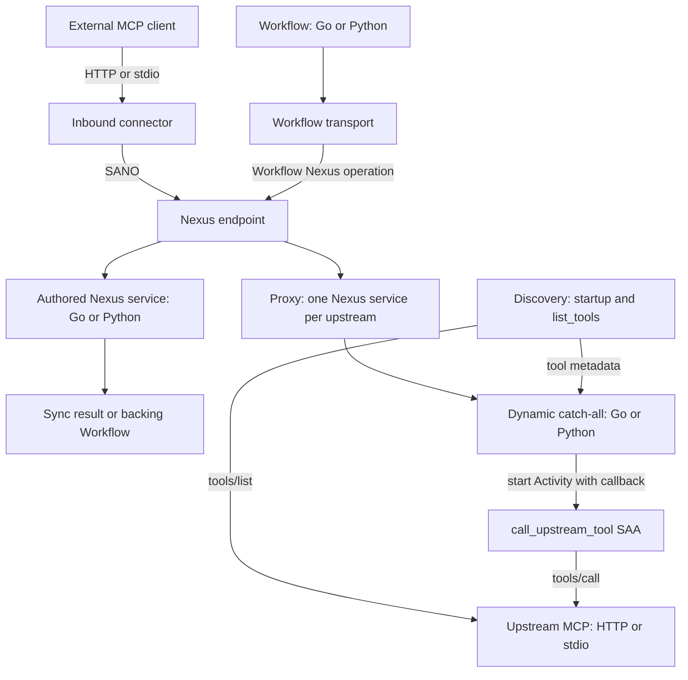
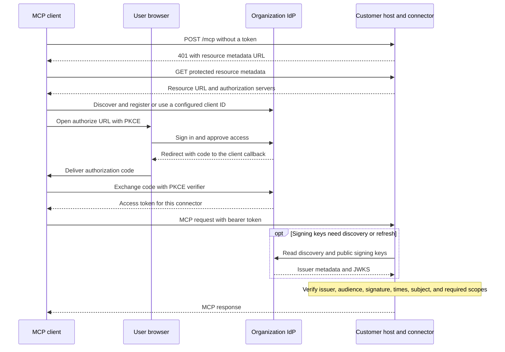
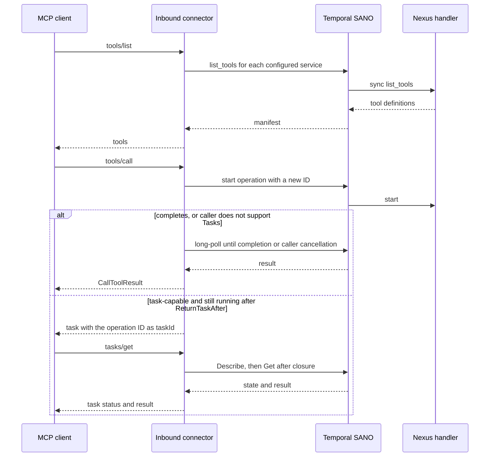
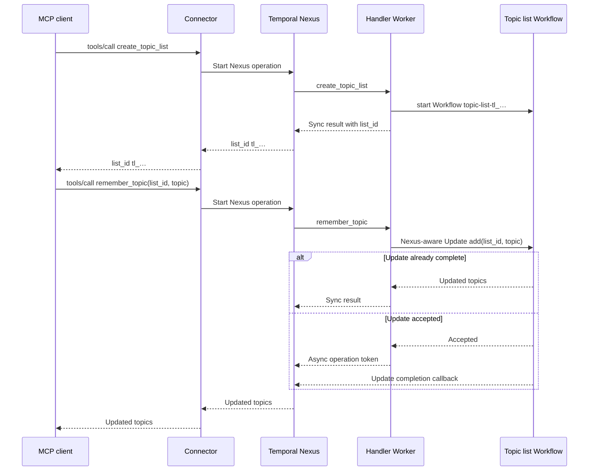

# Architecture

The connector serves callers outside Temporal. Workflow callers use Nexus directly.

## Components

| Component | Code | Role |
|---|---|---|
| Inbound library and reference CLI | `src/inbound/go/` | Serve a standard MCP server over HTTP or stdio. |
| Workflow transport | `src/workflow_transport/go/`, `src/workflow_transport/python/` | Await Nexus operations in Workflow history. Python also has an OpenAI Agents binding. |
| Authoring helpers | `src/authoring/go/`, `src/authoring/python/` | Derive MCP tool definitions from Nexus operations. |
| Outbound proxy | `src/outbound/go/`, `src/outbound/python/` | Worker plugins. Register multiple upstream services and run tool calls in SAAs. |



Inbound uses Go. The other three features have Go and Python implementations.
Go packages share the root module. Python packages retain their existing imports.

## Tool manifest

The authoring helper adds a sync `list_tools` operation. It derives input/output
schemas, descriptions, titles, annotations, and metadata from marked operations.
The authoring helpers use the unified Temporal operation API:
`temporalnexus.NewTemporalOperation` in Go and
`@temporalio.nexus.temporal_operation` / `TemporalOperationHandler` in Python.
Each gets the Nexus-aware client and returns a sync value or an async backing.
See [Temporal Operation Handler](https://docs.temporal.io/nexus/temporal-operation-handler).

```json
{"tools": [{"name": "lookup", "inputSchema": {"type": "object"}}]}
```

- `@nexus_backed_mcp.service` declares `list_tools` below `@nexusrpc.service`. The
  `nexus_backed_mcp` module is safe to import in Workflow code.
- `nexus_backed_mcp.handler` holds the handler APIs:
  - `@service_handler` implements `list_tools` below the Nexus handler decorator. It
    checks tool names and object input schemas when the class is built.
  - `@tool(...)` marks an operation. Unmarked operations stay private by default.
  - `service_handler(expose="all")` exposes all operations except those marked `exclude`.
  - `@tool_errors(...)` turns named exceptions into MCP `isError` results, carried in
    the `io.temporal/mcpCallToolResult` envelope.
- Go uses `authoring.NewService` and typed `authoring.RegisterTool` calls. Unmarked
  operations can be registered directly on `NexusService()` and stay out of MCP
  discovery. Descriptions come from options and `jsonschema` field tags.
- The tool name is the original Nexus operation name. `list_tools` and the SDK
  prefix `__temporal_` are reserved.
- An optional `io.temporal/scheduleToCloseTimeoutMs` tool metadata value bounds the
  Nexus operation. Both caller paths read it.
- Tool annotations remain unchanged through both caller paths.

Services have separate Nexus names, so upstreams can both have a `search` operation.
Both caller paths prefix duplicate names with the service name. If those prefixes
still leave an ambiguous name, discovery fails and preserves the previous routes.

## Short and long tools

| Tool | Nexus handler | Waiting |
|---|---|---|
| Short authored tool | Sync Nexus operation | Returns the value in the start response. |
| Long authored tool | Workflow-backed Temporal operation | Completes through the Nexus callback. |
| Workflow Update-backed tool | Temporal operation using the Nexus-aware client's Update API | Returns a known result inline or completes through the Nexus callback. |
| Any proxied tool | SAA-backed Temporal operation | Completes through the Nexus callback. |

Authoring helpers do not create business Workflows or change handler authorization.
Authors derive backing execution IDs from the Nexus request ID.
The topic-list example creates a separate resource Workflow and returns its handle
with a sync result. It uses the supplied Nexus client's underlying client for that
independent Workflow. `remember_topic` uses the Nexus-aware Workflow Update API.

## Connector path (non-Temporal callers)

`inbound.NewServer(Options)` validates routes and policies and returns `*mcp.Server`.
The host supplies the Temporal client, matching namespace,
transport, HTTP middleware, and lifecycle.
The reference CLI uses the same function.

### Inbound OAuth

The host supplies OAuth middleware. The sample `mcphost.NewOAuthHandler` in
`examples/mcp_host` connects `go-oidc` to the MCP SDK. It is not part of the
connector library API. `go-oidc` handles
discovery, JWT verification, and signing-key caching. MCP SDK middleware handles
bearer tokens, scopes, challenges, and protected resource metadata. A small adapter
maps verified issuer, subject, expiry, and scopes into `TokenInfo`. Its stable
`UserID` is `issuer#subject`; the connector uses it for task ownership.
The host supplies issuer, API audience, scopes, and HTTPS. The CLI loads these
settings from the `auth` section of `--config-file`. See the [Go example](src/inbound/go/example_test.go)
and [YAML settings](examples/inbound_auth.yaml).



The identity provider issues tokens. The MCP client owns login, its callback, and
refresh. A local CLI client can use a loopback callback; hosted clients use their
own callback. The connector has no authorization-code callback or auth Workflow.
This follows [MCP authorization](https://modelcontextprotocol.io/specification/2026-07-28/basic/authorization).

The OAuth handler publishes resource metadata for the configured public MCP URL.
It accepts JWT access tokens from the configured issuers for the connector's API
audience. The SDK middleware checks the verifier's result before
passing a request to MCP. Missing or invalid tokens get `401`; insufficient scopes
get `403`. The host can add per-tool policy. Nexus calls use the supplied Temporal
client's credentials; raw caller tokens stay at the MCP boundary.

### MCP tasks with auth

The task ID is the Nexus operation ID. For authenticated callers, the connector
appends `{owner_hash}-{request_id}` to the generated operation identity. The owner
hash is SHA-256 of the verified `UserID`; the request ID has 128 random bits. The
connector starts operations with `REJECT_DUPLICATE` ID reuse policy and checks
the current caller's owner hash before task reads or cancellation. Task methods
accept only IDs that start with the connector's
operation ID prefix, so they cannot read or cancel other operations in the
namespace. The configured Temporal client supplies the namespace.

`Options.CallerIdentity` supplies the verified identity. The default reads the MCP
SDK token info. A custom callback can call `inbound.RequestExtra(ctx)` to read the
token info or HTTP headers. The owner hash is always SHA-256 of `issuer#subject`.
A reader of the namespace can test whether a known identity made a call.

The client keeps the operation ID. Any replica with access to the same namespace
can read it without a local task store. Refreshed tokens for the same issuer and
subject retain access. Without authentication, possession of the operation ID
grants task access. The owner hash is visible in Temporal operation IDs; raw JWTs
are not sent to Temporal. Temporal permissions control clients that can create
or reuse operation IDs directly. Task access does not grant access to business
resources managed by tools.



Non-task callers have no connector wait timeout. A task-capable caller waits for
`Options.ReturnTaskAfter` / `--return-task-after`. The default `0` returns a task as
soon as the operation starts. A positive value waits up to that duration and
returns the result if it is ready. `NeverReturnTask` / `never` makes task-capable
callers wait like other callers. The suggested task polling interval is two seconds.
The connector keeps no durable task state; replicas read the same Temporal records.

### Tool discovery

`tools/list` calls `list_tools` on all configured services in parallel. A tool name
that only one service exposes stays as it is. A name that several services expose
becomes `{service}_{tool}`, and the connector logs a warning.
`Options.PrefixToolNames` / `--prefix-tool-names` prefixes every name, so names stay
stable when services are added. Names keep their original characters and length.
If service prefixes still leave duplicate names, discovery fails without publishing
new routes. A lookup table maps each exposed name to its service, endpoint, and
operation. The Workflow transports use the same rule.

Every service must succeed before discovery publishes the merged list and routes.
A failure is logged and returned, preserving the previous routes. Every `tools/list`
reads every service; there is no connector cache setting. An unknown tool name
triggers one refresh, then returns `-32602`. Discovery operations have a 30-second
execution timeout, matching the discovery read deadline.

### MCP tasks extension

Clients declare `io.modelcontextprotocol/tasks` in request metadata.
The connector adds custom methods to the pinned MCP Go SDK.

| Method or status | Mapping |
|---|---|
| `tasks/get` | Describe the SANO. Get its result after closure. |
| `tasks/cancel` | Cancel that SANO. |
| `tasks/update` | Unsupported; no input-required task state. |
| Running | `working` |
| Completed | `completed`, with the MCP result. |
| Handler failed | `completed`, with an `isError` result. |
| Canceled | `cancelled` |
| Timed out or terminated | `failed`, with an error. |

Task methods without the extension return `-32021` with `requiredCapabilities`.
Unknown task IDs return `-32602`. Task retention follows namespace retention.
See [MCP tasks with auth](#mcp-tasks-with-auth) for ownership checks.

### Caller cancellation

| Caller | Signal before a task is returned |
|---|---|
| HTTP, MCP 2026-07-28 | Closing that request's SSE response cancels its context. |
| Older HTTP | Explicit `notifications/cancelled`; a disconnect alone is insufficient. |
| stdio | Explicit `notifications/cancelled`, with the tool request ID. |

`NewHTTPHandler` uses stateless HTTP with `PropagateRequestCancellation: true`
for MCP 2026-07-28. It uses the SDK's session handler for older clients, so a
cancellation notification can find the original request. Hosts must route each
legacy session to the same replica. These sessions are temporary; operation and
task state remain in Temporal and operation IDs work across replicas.
The resolver then
cancels only the SANO associated with that request, using a separate cleanup context.
Reaching `ReturnTaskAfter` does not cancel the operation. After a task is returned,
cancellation uses `tasks/cancel`; closing the original request has no effect.

### Namespace and operation identity

The supplied client selects the caller namespace. SANO records, visibility, and
retention belong to that namespace. Nexus endpoint permissions control routing to
the handler namespace.

The operation ID contains
`mcp-inbound-{transport}-{mode}-{service}-{endpoint}-{operation}-{owner_hash}-{random_request_id}`.
Long generated prefixes are shortened with a hash. The connector preserves the
ownership suffix. Anonymous operations omit the owner hash. Task methods look
up the operation ID; a pending tool call also retains its
run ID while waiting for the initial result.

`mode` describes the MCP request protocol: `stateful` before 2026-07-28 and
`stateless` from that version. Only older HTTP clients use temporary SDK sessions.
Task access checks the owner hash in the operation ID.

## In-Workflow client path (Temporal callers)

`InWorkflowClient(service=..., endpoint=..., headers=...)` has no AI SDK types.
The existing `InWorkflowClient({service: endpoint})` form also works. Use a sequence
of `Service(name=..., endpoint=...)` routes to repeat a service on different endpoints.
Tool names use the connector's rule: a name that several services expose becomes
`{service}_{tool}`, and `prefix_tool_names=True` prefixes every name. A lookup table
maps each exposed name to its service and operation. An unknown tool raises
`MCPError` with code -32602, the same code the connector returns.
It uses the Workflow Nexus client for `list_tools` and each tool operation.
The Workflow awaits completion durably, holds no Worker slot while waiting, and
cancels Nexus when the Workflow is canceled. No SANO, connector polling, or MCP Tasks
are involved.

`in_workflow_client.openai_agents.WorkflowNexusMCPServer` implements the OpenAI
Agents MCP server interface. It delegates to the core client and opens no connection.
With `cache_tools_list=True`, it keeps the first tool list, so later agent turns add
no `list_tools` operations to Workflow history.
The example agent imports this binding. Other SDK bindings wrap the same core.

Go uses `workflowtransport.NewClient(Options{Services: ...})`. `ListTools` and
`CallTool` take `workflow.Context` and return official MCP Go SDK types. Services
are an ordered slice so discovery schedules commands in a stable order. Clients
belong to one Workflow execution. The Go core has no agent-framework binding.

For explicit Go Nexus headers, set `Options.Headers` and install
`workflowtransport.HeadersPlugin` on the Workflow Worker and replayer. The plugin
uses the public Workflow interceptor API; it adds no delegated credentials.
Without the plugin, a client configured with headers fails before scheduling a call.

## Result mapping

| Nexus result | MCP result |
|---|---|
| Object | Structured content and the same JSON as text. |
| String | Text. |
| Other JSON value | JSON text. |
| Operation failure | `isError=true`. |
| Proxy MCP result envelope | The original MCP result, including content blocks, metadata, and `isError`. |

The proxy stores a JSON envelope under `io.temporal/mcpCallToolResult`.
Both caller paths decode it. This preserves images, resources, audio, and structured
content without changing normal authored object results.
Discovery preserves declared input and output schemas.

## Outbound proxy

`MCPProxyPlugin(options=Options(upstreams=[Upstream(...)]))` registers one service and one call
Activity per upstream. Services share the host Worker and can share one endpoint.
The host supplies its Temporal client, including namespace, TLS, and payload codec.
SAAs belong to the proxy Worker's namespace.

The Go plugin is `outbound.NewPlugin(outbound.Options{Upstreams: ...})` and is supplied
through `worker.Options.Plugins`. The [Go example](examples/mcp_server/nexus_proxy/proxy_worker.go)
uses the same services and upstreams as the Python example.

### Client factories

A factory returns an async context manager for the official `mcp.client.Client`.
In Go, it returns an official `*mcp.ClientSession`. The proxy closes each client.
It owns the HTTP or stdio transport, auth, and cleanup. Framework-specific clients
can use an adapter. HTTP response waits and MCP read waits have no fixed limit;
the proxy enforces the Activity deadline and uses a short connection deadline.

Activity inputs contain only the tool name and arguments. Client factories, live
connections, configured destinations, and credentials stay in the Worker.
Concurrent calls open separate clients. The HTTP helper also accepts user auth.

### Discovery and dynamic handlers

`Catalog` reads upstream tools directly at startup and on `list_tools`, outside
Activities. It publishes metadata only after all pages succeed. Each upstream
has an independent tool dictionary and a ten-second discovery/connection timeout.

| Upstream change | Behavior |
|---|---|
| Tool added | New calls can use it after discovery. No Worker restart. |
| Tool removed | New calls get `NOT_FOUND`. Existing executions remain reachable. |
| Schema or annotations changed | New starts use the new metadata. Recorded inputs/options stay unchanged. |
| Discovery failed | Keep the last successful dictionary. Log the failure and back off later attempts. Return an availability error if discovery has never succeeded. |

Failures use exponential backoff with jitter. The delay ranges from half to all
of a retry limit that starts at one second and doubles up to one minute. Success
resets the backoff. During backoff, `list_tools` returns the last successful list.
Metadata does not expire. One upstream's failure does not block another.

Each service registers named `list_tools` and one catch-all, once. Go uses
`temporalnexus.MustNewDynamicTemporalOperation`; Python uses
`@temporalio.nexus.temporal_operation(dynamic=True)`. The catch-all receives raw
Nexus input and the original tool name. It reattaches an existing Activity before
reading discovery. New calls look up the tool and resolve its Activity options.
Discovery does not create or replace Nexus handlers.

Cancellation uses the Temporal operation token without looking up the tool, so
removed tools remain cancellable. The proxy keeps no per-execution handler records.

### Activity defaults

These are the values used when the user supplies no override.

| Option | Proxy value |
|---|---|
| `start_to_close_timeout` | One minute per attempt. Override it for long tools. |
| `schedule_to_close_timeout` | Unset. Nexus operation timeout still applies. |
| `schedule_to_start_timeout` | Unset. |
| `heartbeat_timeout` | Off by default. Assumes compatible Server/SDK builds with [system.enableCancelActivityWorkerCommand](https://github.com/temporalio/temporal/blob/bfabec74d7a021e4bb3abd696b0e8157a8fb696a/common/dynamicconfig/constants.go#L228-L232), [frontend.WorkerCommandsEnabled](https://github.com/temporalio/temporal/blob/bfabec74d7a021e4bb3abd696b0e8157a8fb696a/common/dynamicconfig/constants.go#L4003-L4007), and [frontend.WorkerHeartbeatsEnabled](https://github.com/temporalio/temporal/blob/bfabec74d7a021e4bb3abd696b0e8157a8fb696a/common/dynamicconfig/constants.go#L3973-L3977) enabled. |
| `retry_policy` | Native `RetryPolicy()` with no attempt cap, except explicit destructive, non-idempotent tools get one attempt. `readOnlyHint=true` takes precedence. |
| Priority and fairness | Unset; use Temporal defaults. No generated fairness group. |
| Search attributes | Unset. |
| Summary and other scheduling options | Unset; use SDK defaults. |

Go uses native `client.StartActivityOptions` for `Upstream.ActivityOptions` and
`ActivityOptionsOverrides[tool]`. Nonzero fields override the current defaults.
Zero durations, empty strings, nil retry policies, zero priority structs, and
empty search attributes inherit. Zero/empty values cannot clear inherited settings.

Python uses mappings of native `TemporalNexusClient.start_activity` keyword
options for `Upstream.activity_options` and `activity_options_overrides[tool]`.
Absent keys inherit. Present keys replace inherited values, including zero, empty,
or `None` values accepted by the SDK.

Both apply proxy defaults, then upstream defaults, then per-tool overrides.
Native priority, retry policy, and typed search attributes replace whole values;
their members are not merged. An explicit retry policy replaces annotation
inference, including a policy whose maximum attempts is zero.

Native scheduling fields include start-to-close, schedule-to-close,
schedule-to-start, and heartbeat timeouts; retry policy; priority/fairness;
typed search attributes; summary; and start delay. Go also supports static details.

The proxy rejects unsupported keys and connector-owned fields: Activity ID, task
queue, conflict/reuse policies, callback wiring, and argument/result plumbing.
At least one of start-to-close or schedule-to-close must remain set.
When heartbeats are enabled, emit them every three seconds or one third of the
timeout, whichever is shorter. SDK heartbeat throttling still applies.
Set a positive timeout to enable heartbeats for faster Worker failure detection.
Python can set zero or `None` to disable them; Go zero inherits.

### Operation identity

The default backing Activity ID is
`mcp-outbound-{endpoint}-{service}-{operation}-{request_id}`.
The default ID factory receives the original SDK context. Python uses
`TemporalStartOperationContext`, with endpoint from `temporalio.nexus.info()`.
Go uses `context.Context` and `temporalnexus.StartTemporalOperationOptions`:
service/operation from `nexus.ExtractHandlerInfo(ctx)`, endpoint from
`temporalnexus.GetOperationInfo(ctx)`, and request ID from `opts.RequestID`.
The factory returns a deterministic ID across replicas and restarts. It joins the
fields as they are. An ID over Temporal's 1000-byte limit keeps its first 935 bytes
and ends with a SHA-256 hash of the full ID.

A retried Nexus start looks up this ID before discovery. Running Activities use
`USE_EXISTING`; closed Activities return their recorded result. `REJECT_DUPLICATE`
prevents a closed execution from being run again. Existing inputs/options are
unchanged even if the tool was removed or its annotations changed.

This deduplicates Nexus starts. It does not make external effects exactly once.
A remote tool can finish before the response is lost. Safe retries then depend
on the upstream tool's idempotency contract or an upstream idempotency key.

### Errors and cancellation

| Failure | Default |
|---|---|
| Connection failure, timeout, rate limit, server unavailability | Retryable. |
| Authentication, bad configuration, invalid request, protocol incompatibility | Non-retryable. |
| MCP tool result with `isError` | Keep it as a tool result; do not infer a transport retry. |

`Upstream.classify_error(error, default)` returns a stable failure type and
retryability. It runs before a Temporal application failure is raised.
Temporal then applies the native retry policy, including non-retryable error
types, attempt limits, and timeouts. Retry-After is passed as a retry delay when
available. Exceptions sent to Temporal omit upstream messages that may contain
credentials. User hooks must keep their classification names free of secrets.
Cancellation bypasses classification.

Nexus cancellation cancels the SAA. It cancels an upstream call that is still
waiting. The upstream may still finish work already in progress; cancellation
does not undo completed actions. Backoff cancellation is immediate. Cancellation
is delivered through Worker commands.

The proxy does not support upstream MCP Tasks. It rejects an
incomplete result instead of treating a remote task ID as completed output.
Caller-facing Tasks remain the inbound connector's responsibility.

## State across calls

The MCP 2026-07-28 spec removes protocol sessions and the `Mcp-Session-Id` header
([SEP-2567](https://modelcontextprotocol.io/seps/2567-sessionless-mcp)). A server
that needs state across calls returns a handle from a create tool. The model passes
the handle as an argument on each later call.

The connector keeps no tool state. A tool that needs state keeps it in Temporal, for
example in one Workflow per handle. The state then survives Worker restarts and works
with more than one Worker. The example tools `create_topic_list` and `remember_topic`
use this pattern:

- `create_topic_list` mints `tl_` plus 128 random bits, and starts one Workflow for
  the list.
- `remember_topic(list_id, topic)` sends a Workflow Update to that Workflow.
- An unknown or expired list returns `NOT_FOUND`.
- The sample uses the handle to authorize access to the list. It does not bind the
  list to an OAuth caller. Anyone who can invoke the tool and has the handle can use
  the list. The handle has 128 random bits, and the list expires after 30 idle minutes.



## Auth

| Component | Configuration |
|---|---|
| Inbound library | The host supplies OAuth middleware, TLS, and the Temporal client. `examples/mcp_host` demonstrates go-oidc and MCP SDK middleware. |
| Inbound CLI | `--config-file` loads routes and OAuth settings from YAML. HTTP without an `auth` section is unauthenticated. |
| Workflow transport | Forward only supplied Nexus headers. No delegated credential propagation. |
| Authoring | Use existing handler-side Nexus interceptors. |
| Outbound | Factories own destinations, credentials, OAuth, secret rotation, and egress policy. Requests cannot replace them. |
| Payload encryption | Configure the supplied Temporal client's converter/codec. The inbound CLI supports `--codec-endpoint`. |

The prototype does not include third-party OAuth login or refresh, delegated
end-user identity, per-tool policy configuration, container images, a management
plane, or managed hosting.

## Prototype scope and verification

The MCP Go SDK and Temporal dependencies are pinned in the lock files.
Standalone Nexus operations, SAAs, and callbacks need the dev-server settings in
`examples/justfile`. Dynamic dispatch uses the pinned SDK forks.
The prototype implements the inbound connector in Go, the outbound proxy in Go
and Python, and authoring helpers and Workflow clients in Go and Python.

Unit tests cover discovery updates, partial overrides, retry inference, identity,
error classification, result preservation, task thresholds, and cancellation.
The integration suite uses a local Temporal server and real MCP clients, including
a stdio upstream, separate connector processes, and a Workflow caller.
See [tests/README.md](tests/README.md).
