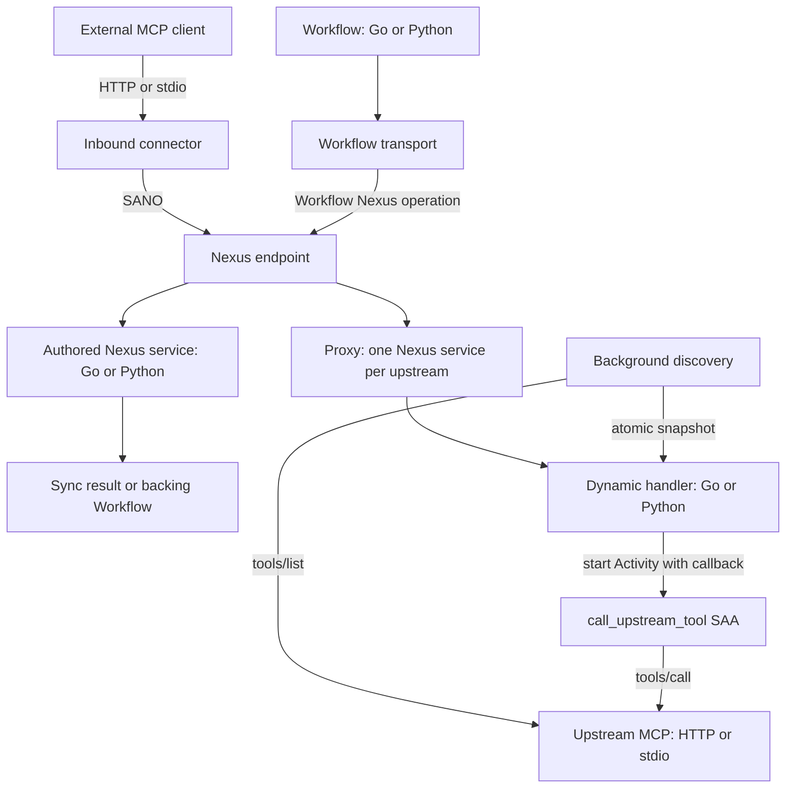
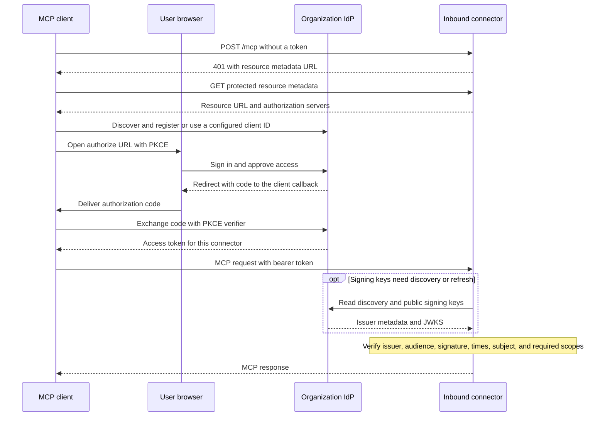
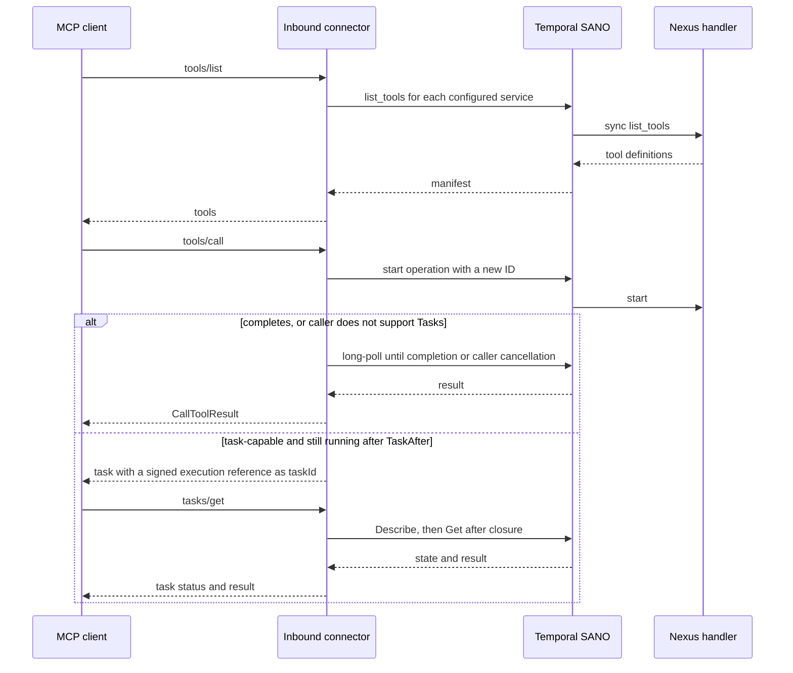
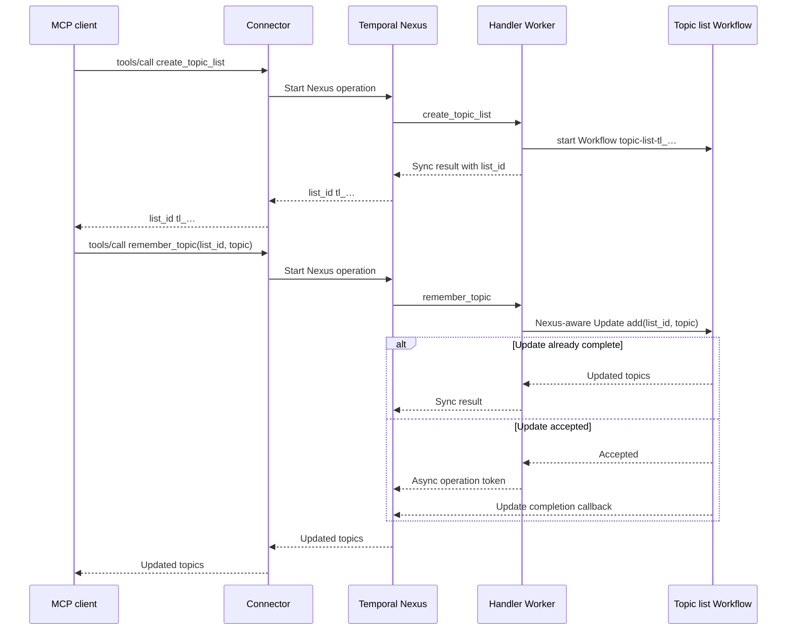

# Architecture

The connector serves callers outside Temporal. Workflow callers use Nexus directly.

## Components

| Component | Code | Role |
|---|---|---|
| Inbound library and reference CLI | `src/inbound/go/` | Serve a standard MCP server over HTTP or stdio. |
| Workflow transport | `src/workflow_transport/go/`, `src/workflow_transport/python/` | Await Nexus operations in Workflow history. Python also has an OpenAI Agents binding. |
| Authoring helpers | `src/authoring/go/`, `src/authoring/python/` | Derive MCP tool definitions from Nexus operations. |
| Outbound proxy | `src/outbound/go/`, `src/outbound/python/` | Worker plugins. Register multiple upstream services and run tool calls in SAAs. |



Inbound uses Go. The other three features have Go and Python implementations.
Go packages share the root module. Python packages retain their existing imports.

## Tool manifest

The authoring helper adds a sync `list_tools` operation. It derives input/output
schemas, descriptions, titles, annotations, and metadata from marked operations.
All handlers, including discovery, use the unified Temporal operation API:
`temporalnexus.NewTemporalOperation` in Go and
`@temporalio.nexus.temporal_operation` / `TemporalOperationHandler` in Python.
Each gets the Nexus-aware client and returns a sync value or an async backing.
See [Temporal Operation Handler](https://docs.temporal.io/nexus/temporal-operation-handler).

```json
{"tools": [{"name": "lookup", "inputSchema": {"type": "object"}}]}
```

- `@nexus_mcp.service` declares `list_tools` below `@nexusrpc.service`.
- `@nexus_mcp.service_handler` implements it below the Nexus handler decorator.
- `@nexus_mcp.tool(...)` marks an operation. Unmarked operations stay private by default.
- `service_handler(expose="all")` exposes all operations except those marked `exclude`.
- Go uses `authoring.NewService` and typed `authoring.RegisterTool` calls. Unmarked
  operations can be registered directly on `NexusService()` and stay out of MCP
  discovery. Descriptions come from options and `jsonschema` field tags.
- The tool name is the Nexus operation name and must match `^[a-zA-Z0-9_-]{1,64}$`.
- An optional `io.temporal/scheduleToCloseTimeoutMs` tool metadata value bounds the
  Nexus operation. Both caller paths read it.
- Tool annotations remain unchanged through both caller paths.

Services have separate Nexus names, so upstreams can both have a `search` operation.
A client that combines those services into one unqualified tool list rejects
duplicate names. Use separate Workflow bindings or connector routes for such services.

## Short and long tools

| Tool | Nexus handler | Waiting |
|---|---|---|
| Short authored tool | Sync Nexus operation | Returns the value in the start response. |
| Long authored tool | Workflow-backed Temporal operation | Completes through the Nexus callback. |
| Workflow Update-backed tool | Temporal operation using the Nexus-aware client's Update API | Returns a known result inline or completes through the Nexus callback. |
| Any proxied tool | SAA-backed Temporal operation | Completes through the Nexus callback. |

Authoring helpers do not create business Workflows or change handler authorization.
Authors derive backing execution IDs from the Nexus request ID.
The topic-list example creates a separate resource Workflow and returns its handle
with a sync result. It uses the supplied Nexus client's underlying client for that
independent Workflow. `remember_topic` uses the Nexus-aware Workflow Update API.

## Connector path (non-Temporal callers)

`inbound.NewServer(Options)` validates routes and policies and returns `*mcp.Server`.
The host supplies the Temporal client, matching namespace, task signing key,
transport, HTTP middleware, and lifecycle.
The reference CLI uses the same function.

### Inbound OAuth

`NewHTTPHandler` can protect the HTTP endpoint as an OAuth resource server.
The CLI enables it with `--auth-config`. `NewServer` still supports a host's own
transport and middleware. stdio uses the host's local credentials and configuration.

The `inbound/auth` package owns auth configuration, discovery metadata, bearer
checks, and token verification. It wraps an HTTP handler and has no Temporal or
Nexus dependencies. The inbound package owns HTTP hosting and task ownership.



The identity provider issues tokens. The MCP client owns login, its callback, and
refresh. A local CLI client can use a loopback callback; hosted clients use their
own callback. The connector has no authorization-code callback or auth Workflow.
This follows [MCP authorization](https://modelcontextprotocol.io/specification/2026-07-28/basic/authorization).

The public resource metadata names the trusted authorization servers. The endpoint
checks every request's JWT access token against configured issuer/audience pairs.
Discovery and signing keys are cached, with bounded fetches and refresh intervals.
Missing or invalid tokens get `401` and a `WWW-Authenticate` discovery challenge.
Missing required scopes get `403`. If verification is unavailable, the request
fails with `500`; it does not start an interactive login to hide the outage.

All accepted callers can use the configured tools. A host can add MCP middleware
for per-tool policy using verified `TokenInfo`. The connector does not delegate
the caller's credentials or identity to Nexus handlers. The supplied Temporal
client still determines Temporal permissions. Raw tokens never enter Temporal.

### MCP tasks with auth

Task IDs contain a base64url-encoded JSON reference and an HMAC-SHA256 signature.
The reference holds a version, namespace, operation ID, run ID, and a hash of the
verified issuer/subject identity. The client retains this string. The connector
keeps no task-to-owner store. It verifies the signature, namespace, and current
caller before reading or canceling the exact Temporal execution. Operation IDs
are opaque to this check; their prefixes have no role in task access.

Library hosts supply `Options.Namespace` and `Options.TaskSigningKey`. The CLI
reads `MCP_TASK_SIGNING_KEY`, a base64-encoded secret of at least 32 random bytes.
Replicas and restarts share the key and namespace. HTTP requires a configured key.
Local stdio examples can use a process-local generated key. Changing the key
invalidates existing task IDs. The key is separate from the IdP's signing keys.

Refreshed tokens for the same issuer/subject retain access. Another caller cannot
access a task even with its ID. Expired tokens get `401` on task requests; the
client obtains a new token and retries with the same task ID. The work continues.
Task contents are readable, but changing them invalidates the signature. The JWT
and owner hash stay at the MCP boundary and are not sent to Temporal. Task scope
is separate from access to business resources managed by the tools.



Non-task callers have no connector wait timeout. A task-capable caller waits for
`Options.TaskAfter` / `--task-after`, which defaults to two seconds. This is a
connector policy. The suggested task polling interval is a separate two seconds.
The connector keeps no durable task state; replicas read the same Temporal records.

### MCP tasks extension

Clients declare `io.modelcontextprotocol/tasks` in request metadata.
The connector adds custom methods to the pinned MCP Go SDK.

| Method or status | Mapping |
|---|---|
| `tasks/get` | Describe the SANO. Get its result after closure. |
| `tasks/cancel` | Cancel that SANO. |
| `tasks/update` | Unsupported; no input-required task state. |
| Running | `working` |
| Completed | `completed`, with the MCP result. |
| Handler failed | `completed`, with an `isError` result. |
| Canceled | `cancelled` |
| Timed out or terminated | `failed`, with an error. |

Task methods without the extension return `-32021` with `requiredCapabilities`.
Unknown task IDs return `-32602`. Task retention follows namespace retention.
See [MCP tasks with auth](#mcp-tasks-with-auth) for signatures and ownership checks.

### Caller cancellation

| Caller | Signal before a task is returned |
|---|---|
| HTTP, MCP 2026-07-28 | Closing that request's SSE response cancels its context. |
| Older HTTP | Explicit `notifications/cancelled`; a disconnect alone is insufficient. |
| stdio | Explicit `notifications/cancelled`, with the tool request ID. |

`NewHTTPHandler` uses stateless HTTP with `PropagateRequestCancellation: true`
for MCP 2026-07-28. It uses the SDK's session handler for older clients, so a
cancellation notification can find the original request. Hosts must route each
legacy session to the same replica. These sessions are temporary; operation and
task state remain in Temporal and signed task references work across replicas.
The resolver then
cancels only the SANO associated with that request, using a separate cleanup context.
Reaching `TaskAfter` does not cancel the operation. After a task is returned,
cancellation uses `tasks/cancel`; closing the original request has no effect.

### Namespace and operation identity

The supplied client selects the caller namespace. SANO records, visibility, and
retention belong to that namespace. Nexus endpoint permissions control routing to
the handler namespace.

The default operation ID contains
`mcp-inbound-{transport}-{mode}-{service}-{endpoint}-{operation}-{random_request_id}`.
An optional connector name is included after `mcp-inbound`.
`OperationIDPrefix` / `--operation-id-prefix` can replace the generated prefix.
Long IDs are shortened with a hash. The random suffix has 128 bits.
The returned run ID is kept with the operation ID. All reads and cancellation
target that run, so reusing an operation ID cannot redirect an existing task.

`mode` describes the MCP request protocol: `stateful` before 2026-07-28 and
`stateless` from that version. Only older HTTP clients use temporary SDK sessions.
Task access uses the signed reference rather than the operation ID format.

## In-Workflow client path (Temporal callers)

`InWorkflowClient(service=..., endpoint=..., headers=...)` has no AI SDK types.
The existing `InWorkflowClient({service: endpoint})` form also works.
It uses the Workflow Nexus client for `list_tools` and each tool operation.
The Workflow awaits completion durably, holds no Worker slot while waiting, and
cancels Nexus when the Workflow is canceled. No SANO, connector polling, or MCP Tasks
are involved.

`in_workflow_client.openai_agents.WorkflowNexusMCPServer` implements the OpenAI
Agents MCP server interface. It delegates to the core client and opens no connection.
The example agent imports this binding. Other SDK bindings wrap the same core.

Go uses `workflowtransport.NewClient(Options{Services: ...})`. `ListTools` and
`CallTool` take `workflow.Context` and return official MCP Go SDK types. Services
are an ordered slice so discovery schedules commands in a stable order. Clients
belong to one Workflow execution. The Go core has no agent-framework binding.

For explicit Go Nexus headers, set `Options.Headers` and install
`workflowtransport.HeadersPlugin` on the Workflow Worker and replayer. The plugin
uses the public Workflow interceptor API; it adds no delegated credentials.
Without the plugin, a client configured with headers fails before scheduling a call.

## Result mapping

| Nexus result | MCP result |
|---|---|
| Object | Structured content and the same JSON as text. |
| String | Text. |
| Other JSON value | JSON text. |
| Operation failure | `isError=true`. |
| Proxy MCP result envelope | The original MCP result, including content blocks, metadata, and `isError`. |

The proxy stores a JSON envelope under `io.temporal/mcpCallToolResult`.
Both caller paths decode it. This preserves images, resources, audio, and structured
content without changing normal authored object results.
Discovery preserves declared input and output schemas.

## Outbound proxy

`MCPProxyPlugin(upstreams=[Upstream(...)])` registers one service and one call
Activity per upstream. Services share the host Worker and can share one endpoint.
The host supplies its Temporal client, including namespace, TLS, and payload codec.
SAAs belong to the proxy Worker's namespace.

The Go plugin is `outbound.NewPlugin([]outbound.Upstream)` and is supplied
through `worker.Options.Plugins`. The [Go example](examples/mcp_server/nexus_proxy/proxy_worker.go)
uses the same services and upstreams as the Python example.

### Client factories

A factory returns an async context manager for the official `mcp.client.Client`.
In Go, it returns an `outbound.MCPClient`; `*mcp.ClientSession` implements the
required `ListTools`, `CallTool`, and `Close` methods. The proxy closes each client.
It owns the HTTP or stdio transport, auth, and cleanup. Framework-specific clients
can use an adapter. HTTP response waits and MCP read waits have no fixed limit;
the proxy enforces the Activity deadline and uses a short connection deadline.

Activity inputs contain only the tool name and arguments. Client factories, live
connections, configured destinations, and credentials stay in the Worker.
Concurrent calls open separate clients. The HTTP helper also accepts user auth.

### Discovery and dynamic handlers

`Catalog` refreshes tools directly, outside Activities. It reads all pages before
publishing a snapshot. Failed refreshes do not replace a usable snapshot.
Each upstream has an independent catalog and refresh task.
`list_tools` returns a usable snapshot and requests a background refresh.

| Upstream change | Behavior |
|---|---|
| Tool added | New calls can use it after refresh. No Worker restart. |
| Tool removed | New calls get `NOT_FOUND`. Existing executions remain reachable. |
| Schema or annotations changed | New starts use the new snapshot. Recorded inputs/options stay unchanged. |
| Refresh failed | Keep a snapshot within the age limit; otherwise return availability error. |

Discovery settings are on `Upstream`. Prototype defaults are a 30-second refresh
interval, five-minute maximum snapshot age, and ten-second discovery/connection
timeout. Each upstream can override these settings.

The proxy uses the public `nexusrpc.handler.ServiceHandlerBuilder`. `list_tools`
is a named operation; a dynamic handler forwards tool calls. It consumes raw input
with the configured converter. Cancellation uses the operation token, so removed
tools remain cancellable. Start checks the catalog only after checking for an
existing Activity.
Go uses `nexus.Service.RegisterDynamicOperation` with a Temporal operation handler
and the same routing behavior.

### Activity defaults

These are the values used when the user supplies no override.

| Option | Proxy value |
|---|---|
| `start_to_close_timeout` | One minute per attempt. Override it for long tools. |
| `schedule_to_close_timeout` | Unset. Nexus operation timeout still applies. |
| `schedule_to_start_timeout` | Unset. |
| `heartbeat_timeout` | Ten seconds. Record heartbeats every three seconds, independent of upstream progress. |
| `retry_policy` | Native `RetryPolicy()` with no attempt cap, except explicit destructive, non-idempotent tools get one attempt. `readOnlyHint=true` takes precedence. |
| Priority and fairness | Unset; use Temporal defaults. No generated fairness group. |
| Search attributes | Unset. |
| Summary, start delay, other public SAA options | Unset; use SDK defaults. |

`Upstream.activity_options` supplies upstream settings.
`activity_options_overrides[tool_name]` then replaces only supplied keys.
Values use native SAA names and types, including `Priority`, `RetryPolicy`, and
`TypedSearchAttributes`. An explicit retry policy replaces annotation inference.
Nested native objects such as `Priority` are replaced as whole values.
Go uses callbacks that modify the resolved `client.StartActivityOptions`.
The upstream callback runs first, then the per-tool callback. Set a field to zero
to clear it. Both callbacks must support concurrent calls.

The proxy rejects unsupported keys and connector-owned fields: Activity ID, task
queue, conflict/reuse policies, callback wiring, and argument/result plumbing.
Use `Upstream.activity_id(context)` to customize identity.
At least one of start-to-close or schedule-to-close must remain set.
If a user shortens the heartbeat timeout, the timer is shortened to at most one
third of that timeout. SDK heartbeat throttling still applies.

### Operation identity

The default backing Activity ID is
`mcp-outbound-{endpoint}-{service}-{operation}-{request_id}`.
The optional ID factory gets those four fields. It must return a deterministic
ID across replicas and restarts. The proxy validates the size; the default factory
normalizes and hashes IDs when needed.

A retried Nexus start looks up this ID before discovery. Running Activities use
`USE_EXISTING`; closed Activities return their recorded result. `REJECT_DUPLICATE`
prevents a closed execution from being run again. Existing inputs/options are
unchanged even if the tool was removed or its annotations changed.

This deduplicates Nexus starts. It does not make external effects exactly once.
A remote tool can finish before the response is lost. Safe retries then depend
on the upstream tool's idempotency contract or an upstream idempotency key.

### Errors and cancellation

| Failure | Default |
|---|---|
| Connection failure, timeout, rate limit, server unavailability | Retryable. |
| Authentication, bad configuration, invalid request, protocol incompatibility | Non-retryable. |
| MCP tool result with `isError` | Keep it as a tool result; do not infer a transport retry. |

`Upstream.classify_error(error, default)` returns a stable failure type and
retryability. It runs before a Temporal application failure is raised.
Temporal then applies the native retry policy, including non-retryable error
types, attempt limits, and timeouts. Retry-After is passed as a retry delay when
available. Exceptions sent to Temporal omit upstream messages that may contain
credentials. User hooks must keep their classification names free of secrets.
Cancellation bypasses classification.

Nexus cancellation cancels the SAA. It cancels an upstream call that is still
waiting. The upstream may still finish work already in progress; cancellation
does not undo completed actions. Backoff cancellation is immediate. Heartbeats
detect failed Workers and deliver cancellation on SDK versions that require them.

The proxy does not support upstream MCP Tasks. It rejects an
incomplete result instead of treating a remote task ID as completed output.
Caller-facing Tasks remain the inbound connector's responsibility.

## State across calls

The MCP 2026-07-28 spec removes protocol sessions and the `Mcp-Session-Id` header
([SEP-2567](https://modelcontextprotocol.io/seps/2567-sessionless-mcp)). A server
that needs state across calls returns a handle from a create tool. The model passes
the handle as an argument on each later call.

The connector keeps no tool state. A tool that needs state keeps it in Temporal, for
example in one Workflow per handle. The state then survives Worker restarts and works
with more than one Worker. The example tools `create_topic_list` and `remember_topic`
use this pattern:

- `create_topic_list` mints `tl_` plus 128 random bits, and starts one Workflow for
  the list.
- `remember_topic(list_id, topic)` sends a Workflow Update to that Workflow.
- An unknown or expired list returns `NOT_FOUND`.
- The sample uses the handle to authorize access to the list. It does not bind the
  list to an OAuth caller. Anyone who can invoke the tool and has the handle can use
  the list. The handle has 128 random bits, and the list expires after 30 idle minutes.



## Auth

| Component | Configuration |
|---|---|
| Inbound library | Optional OAuth resource-server HTTP handler, or host-supplied middleware. The host supplies TLS and the Temporal client. |
| Inbound CLI | `--auth-config` enables JWT verification, discovery metadata, optional required scopes, and caller-scoped tasks. HTTP only. |
| Workflow transport | Forward only supplied Nexus headers. No delegated credential propagation. |
| Authoring | Use existing handler-side Nexus interceptors. |
| Outbound | Factories own destinations, credentials, OAuth, secret rotation, and egress policy. Requests cannot replace them. |
| Payload encryption | Configure the supplied Temporal client's converter/codec. The inbound CLI supports `--codec-endpoint`. |

The prototype does not include third-party OAuth login or refresh, delegated
end-user identity, per-tool policy configuration, container images, a management
plane, or managed hosting.

## Prototype scope and verification

The MCP Go SDK and Temporal dependencies are pinned in the lock files.
Standalone Nexus operations, SAAs, and callbacks need the dev-server settings in
`examples/justfile`. Dynamic dispatch uses the pinned SDK forks.
The prototype implements the inbound connector in Go, the outbound proxy in Go
and Python, and authoring helpers and Workflow clients in Python.

Unit tests cover discovery updates, partial overrides, retry inference, identity,
error classification, result preservation, task thresholds, and cancellation.
The integration suite uses a local Temporal server and real MCP clients, including
a stdio upstream, separate connector processes, and a Workflow caller.
See [tests/README.md](tests/README.md).
