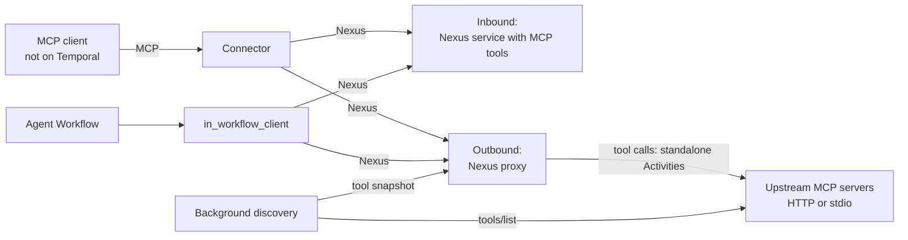

# Durable MCP Connector

MCP connector for Temporal Nexus. The MCP client can be a Temporal Workflow or any
other MCP client.

- Inbound: the MCP server is a Nexus service.
- Outbound: a Nexus proxy fronts upstream MCP servers over HTTP or stdio. Every tool call
  runs in a standalone Activity. Discovery runs outside Activities.

This repository is a prototype. See [ARCHITECTURE.md](ARCHITECTURE.md) for the design.



Callers use the same connector and in-Workflow client for both. The tool name is the
Nexus operation name in both cases.

## Components

| Directory | Feature | Languages |
|---|---|---|
| `src/inbound/` | MCP server over HTTP or stdio. A library and binary for callers outside Temporal. | [Go](src/inbound/go/README.md) |
| `src/workflow_transport/` | List and call tools from Workflow code through Nexus. | [Go](src/workflow_transport/go/README.md), [Python](src/workflow_transport/python/README.md) |
| `src/authoring/` | Expose native Nexus operations as MCP tools. | [Go](src/authoring/go/README.md), [Python](src/authoring/python/README.md) |
| `src/outbound/` | Worker plugins that front upstream MCP servers. Tool calls run in standalone Activities. | [Go](src/outbound/go/README.md), [Python](src/outbound/python/README.md) |

Implementation code lives under `src/`. Go uses one module at the repository root.
Python uses a uv workspace with one package per feature. `examples/` holds runnable
hosts and callers. `tests/` holds cross-component integration tests. Unit tests
stay with each implementation.

## Requirements

- Go 1.26 or later
- Python 3.11 or later and [uv](https://docs.astral.sh/uv/)
- [just](https://github.com/casey/just)
- Temporal CLI 1.9.1 or later. The dev server must enable standalone Nexus operations,
  standalone activities, and activity callbacks. `just temporal` in `examples/` does this.

The prototype pins Temporal and Nexus RPC SDK fork commits for dynamic service
composition. Python pins are in `pyproject.toml` and `uv.lock`; Go replacements
are in `go.mod`. Imports keep their normal SDK package names.
The first Python install builds the Temporal Rust bridge and requires Rust and
Protocol Buffers (`protoc`).

## Build and test

```sh
uv sync
(cd examples && just build)   # builds bin/durable-mcp-connector
just test                    # Go and Python unit tests
```

## Author a tool service

Go authors use `authoring.NewService` and `authoring.RegisterTool` with native
Nexus operations. See the [Go guide](src/authoring/go/README.md) and
[tool Worker](examples/mcp_server/nexus_backed/lucky_number_tools.go).
Run `just nexus-backed-go` from `examples/` in place of the Python tool Worker.

Keep the nexusrpc decorators. Add the MCP decorators below them.
Handlers use Temporal's [unified operation API](https://docs.temporal.io/nexus/temporal-operation-handler)
in both languages.

```python
from datetime import timedelta

import nexus_backed_mcp as nexus_mcp
import nexusrpc
import nexusrpc.handler
import temporalio.nexus


@nexusrpc.service(name="my-tools")
@nexus_mcp.service                      # declares list_tools
class MyService:
    lookup: nexusrpc.Operation[LookupInput, str]
    run_report: nexusrpc.Operation[ReportInput, Report]


@nexusrpc.handler.service_handler(service=MyService)
@nexus_mcp.service_handler              # implements list_tools
class MyTools:
    @nexus_mcp.tool(title="Look up a key")
    @temporalio.nexus.temporal_operation
    async def lookup(
        self,
        ctx: temporalio.nexus.TemporalStartOperationContext,
        client: temporalio.nexus.TemporalNexusClient,
        input: LookupInput,
    ) -> temporalio.nexus.TemporalOperationResult[str]:
        """Short tool. A sync Nexus operation."""
        return temporalio.nexus.TemporalOperationResult.sync("Found a value.")

    @nexus_mcp.tool(title="Run a report", schedule_to_close_timeout=timedelta(minutes=30))
    @temporalio.nexus.temporal_operation
    async def run_report(
        self,
        ctx: temporalio.nexus.TemporalStartOperationContext,
        client: temporalio.nexus.TemporalNexusClient,
        input: ReportInput,
    ) -> temporalio.nexus.TemporalOperationResult[Report]:
        """Long tool. ReportWorkflow does the work."""
        return await client.start_workflow(ReportWorkflow.run, input, id=f"report-{ctx.request_id}")
```

| Decorator | Put it | Does |
|---|---|---|
| `@nexus_mcp.service` | Below `@nexusrpc.service` | Adds the `list_tools` operation to the service definition |
| `@nexus_mcp.service_handler` | Below `@nexusrpc.handler.service_handler` | Adds the `list_tools` implementation to the handler |
| `@nexus_mcp.tool(...)` | Above `@temporalio.nexus.temporal_operation` | Marks the operation as a tool. Sets title, annotations, metadata, and `schedule_to_close_timeout`. |
| `@nexus_mcp.exclude` | Above `@temporalio.nexus.temporal_operation` | Keeps the operation out of the tools of an `expose="all"` handler |

Tools are opt-in by default. An operation without `@nexus_mcp.tool` is not a tool. With
`@nexus_mcp.service_handler(expose="all")`, every operation is a tool, except those with
`@nexus_mcp.exclude`. The tool name is the Nexus operation name. The description
defaults to the method docstring.

`schedule_to_close_timeout` bounds each call of the tool. The connector and the
in-Workflow client set it on the Nexus operation.

## Outbound: front an upstream MCP server

`MCPProxyPlugin(upstreams=[...])` registers one Nexus service per upstream. Services
can share a Worker and endpoint. The upstream servers need no changes.

Go provides the same proxy through `outbound.NewPlugin([]outbound.Upstream)`.
See the [Go library guide](src/outbound/go/README.md) and
[example Worker](examples/mcp_server/nexus_proxy/proxy_worker.go).
Run `just nexus-proxy-go` from `examples/` to use it instead of the Python Worker.

```python
from datetime import timedelta

from nexus_proxy_mcp import MCPProxyPlugin, Upstream, http_client_factory
from temporalio.common import RetryPolicy
from temporalio.worker import Worker

proxy = MCPProxyPlugin(upstreams=[
    Upstream(
        service="weather-tools",
        client_factory=http_client_factory("https://mcp.example.com/mcp",
            headers={"Authorization": f"Bearer {token}"}),
        activity_options_overrides={
            "get_weather": {"start_to_close_timeout": timedelta(seconds=3)},
            "get_forecast_report": {
                "start_to_close_timeout": timedelta(hours=48),
                "retry_policy": RetryPolicy(maximum_attempts=3),
            },
        },
    ),
])
worker = Worker(client, task_queue="weather-proxy", plugins=[proxy])
```

- Each `Upstream` takes a factory for an official MCP SDK client. The factory owns
  HTTP or stdio, authentication, and cleanup. Credentials stay in the Worker.
- Native SAA options go on `Upstream.activity_options` or in
  `activity_options_overrides[tool_name]`. Only supplied keys change.
  Priority, fairness, search attributes, summary, and start delay use SDK types.
- The proxy refreshes each tool catalog in the background. `list_tools` returns
  its latest usable snapshot. Discovery does not schedule Activities.
- The default attempt timeout is **one minute**. Read-only and other eligible tools
  use the default Temporal retry policy, with no attempt cap. Explicit destructive,
  non-idempotent tools get one attempt. An explicit retry policy replaces inference.
- Existing calls keep their recorded inputs/options after discovery changes.
  A retried Nexus start reattaches before reading discovery.
- Tool results keep their text, images, resources, structured content, metadata,
  and `isError` flag. Transport failures use stable Temporal error types.

See [Activity defaults](ARCHITECTURE.md#activity-defaults),
[error handling](ARCHITECTURE.md#errors-and-cancellation), and the
[proxy example](examples/mcp_server/nexus_proxy/proxy_worker.py), which includes
HTTP and stdio factories in one plugin.

## Call the tools

From Workflow code, use `InWorkflowClient`. It returns MCP tool definitions and MCP tool
results:

```python
from in_workflow_client import InWorkflowClient

client = InWorkflowClient(service="my-tools", endpoint="my-tools-endpoint")
tools = await client.list_tools()
result = await client.call_tool("lookup", {"key": "a"})
```

Go Workflows use `workflowtransport.NewClient`, `ListTools(ctx)`, and
`CallTool(ctx, name, arguments)`, with `workflow.Context`. See the
[Go guide](src/workflow_transport/go/README.md) and
[caller Worker](examples/mcp_client/temporal_client.go).
Run `just workflow-caller-go` from `examples/` for a call without an LLM.

Use `in_workflow_client.openai_agents.WorkflowNexusMCPServer(service=..., endpoint=...)`
for the OpenAI Agents SDK. The core client has no AI SDK dependency.
[`temporal_agent.py`](examples/mcp_client/temporal_agent.py) uses this binding.

From any MCP host, add the connector as a stdio MCP server:

```json
{
  "mcpServers": {
    "my-tools": {
      "command": "durable-mcp-connector",
      "args": ["--service", "my-tools", "--endpoint", "my-tools-endpoint"],
      "env": {"TEMPORAL_ADDRESS": "localhost:7233", "TEMPORAL_NAMESPACE": "default"}
    }
  }
}
```

## Connector flags

| Flag | Default | Meaning |
|---|---|---|
| `--service SERVICE --endpoint ENDPOINT` | none | Nexus service and endpoint. Repeat for more services. |
| `--transport` | `stdio` | `stdio` or `http` (Streamable HTTP) |
| `--addr` | `127.0.0.1:8080` | Listen address for `http` |
| `--task-after` | `2s` | Initial wait before returning a task to a task-capable caller. Other callers wait until completion or recognized cancellation. |
| `--connector-name` | none | Logical deployment name, shared by replicas and included in operation IDs. |
| `--operation-id-prefix` | generated | Override the prefix before the random request ID. Share it across replicas. |
| `--codec-endpoint` | none | URL of a remote codec server. Set it when the Nexus handler encodes payloads, for example to encrypt them. The codec must match the codec of the handler. |

The connector reads Temporal connection settings from the environment and from a
`temporal.toml` profile: `TEMPORAL_ADDRESS`, `TEMPORAL_NAMESPACE`, `TEMPORAL_PROFILE`,
`TEMPORAL_CONFIG_FILE`, and related variables. Set the caller namespace with
`TEMPORAL_NAMESPACE`.

## Use the connector as a Go library

Call `inbound.NewServer(inbound.Options{Client: temporalClient, Services: ...})`.
The result is a standard `*mcp.Server`. The host supplies credentials, namespace,
TLS, and the data converter or codec on the Temporal client. The host then serves
HTTP or stdio and supplies its own middleware.
See the [HTTP middleware example](src/inbound/go/example_test.go).

For HTTP, set `Stateless: true` and `PropagateRequestCancellation: true` on the
MCP handler. For current HTTP clients, closing the response stream cancels that
call. Older HTTP clients and stdio clients use explicit MCP cancellation.
After a task is returned, use `tasks/cancel`.

## Examples

See [examples](examples/README.md).
